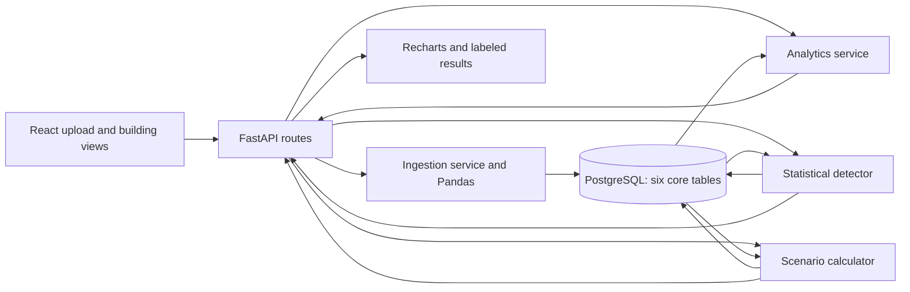

# Architecture and data flow

Status: design only; no application implementation is authorized in this phase. Product scope is defined in [PROJECT_SPEC.md](PROJECT_SPEC.md); persistence and wire contracts are in [DATABASE_SCHEMA.md](DATABASE_SCHEMA.md) and [API_CONTRACT.md](API_CONTRACT.md).

## Modular monolith

One React + TypeScript + Vite frontend talks to one FastAPI application and one PostgreSQL database. Recharts renders observed consumption and separate scenario comparisons. SQLAlchemy owns persistence, Alembic owns schema migrations, and Pandas supports CSV processing and descriptive statistics. No worker queue, microservices, vector database, external AI dependency, or additional application tables are planned.

Planned backend boundaries (logical modules, not files created in this phase):

- **Buildings:** create/read building settings; accept only IANA timezone `Asia/Kolkata` in the sprint MVP. General timezone/DST support is deferred.
- **Ingestion:** bound and parse CSVs, normalize timestamps, validate rows, deduplicate, and commit upload metadata plus readings.
- **Analytics:** range validation, hourly/daily summaries, coverage, and provenance.
- **Anomalies:** historical comparison groups, deterministic thresholds, alert reconciliation, and templated explanations.
- **Simulations:** immutable scenario definitions and persisted calculation snapshots.
- **Shared infrastructure:** configuration, database sessions, transaction boundaries, error translation, and numeric/time serialization.

Routes validate transport inputs and delegate to application services. Services own business rules and transactions. Query/repository functions own SQLAlchemy access. Share range, provenance, precision, and timezone helpers; the frontend must not independently calculate authoritative savings or thresholds.

The frozen UI scope is defined in [UI_SPEC.md](UI_SPEC.md): building selection/creation, CSV ingestion, selected-building analytics, readings with alert markers, and saved scenario estimates. There is no campus aggregate, building comparison, diurnal chart, virtualization requirement, continuous threshold response, or additional styling-framework requirement.

## Data flow

1. Resolve the building; enforce upload size before unbounded parsing. Compute a SHA-256 digest of the original bytes and check for an existing successful import for that building.
2. Apply the strict CSV grammar in [API_CONTRACT.md](API_CONTRACT.md#strict-csv-grammar), including blank/whitespace/ragged-record rejection. Preserve raw text for timestamp and decimal validation before Pandas conversion: do not infer missing values, skip blank records, or round input through floating-point parsing. Check headers/counts and every validly parsed record. Error details are capped at 20 while the discovered error count is retained. Normalize accepted timestamps to UTC; do not resample or fill stored readings.
3. After validation, insert a `succeeded` upload and all readings in one transaction. Database uniqueness resolves concurrent duplicates/conflicts. On rejection, rollback any reading work and persist a terminal `rejected` upload in a separate transaction. Duplicate-file retries return the existing upload instead. Requests rejected before parsing (such as unknown buildings or oversized files) need not create upload records.
4. Compute analytics from stored readings at request time. Each analytics, detection, or simulation operation materializes its required readings from one consistent database snapshot; derive all counts and calculations from that snapshot. Return hourly observations through the readings endpoint and local-date aggregates through analytics. Only explicit detector runs change alerts.
5. Detection reads the selected window plus the preceding history, reconciles alerts in one transaction, and returns evaluated/eligible/skipped counts. The operation is synchronous. Counts describe only that immediate POST response; they are not stored or reconstructed by an alert GET.
6. Simulation reads a complete baseline and selected scenario, calculates estimates, and commits one immutable result. Return the model version, source provenance, rate snapshot, and calculation time with the estimate.

## Time, coverage, and precision

- One row is one hour of energy in kWh, starting at its timestamp. UTC is the storage key; `Asia/Kolkata` controls daily grouping and scenario selection. Other building timezones return `422 VALIDATION_ERROR`; general DST and cross-timezone comparison are deferred.
- `from` is inclusive and `to` is exclusive. Inputs require explicit offsets; convert to the building timezone before checking that local minute/second/fraction equal zero. Any valid submitted offset is accepted, so equivalent instants and UTC responses can be reused. Duration must be an integral 1–744 elapsed hours. Query parameters containing `+` must be URL-encoded.
- Expected hours = elapsed UTC seconds / 3,600. Observed hours = unique stored instants in the window. Coverage = observed / expected; missing hours = expected minus observed. A complete Kolkata day has 24 expected hours; partial days use the requested window boundaries.
- Analytics over incomplete data sum only recorded energy and divide the mean by observed hours. Do not count missing hours as zero. No-data totals, mean, and peak are `null`; coverage is zero. Charts leave gaps.
- The UI constructs an hourly UTC display grid over `[from,to)` and joins returned readings onto it. Missing instants get null chart values and visible gaps (`connectNulls=false`); zero readings remain zero. These display-only placeholders never enter the API, database, analytics, or simulation calculations. Map `consumption_kwh` to the consumption line and join alert markers by UTC instant; do not infer thresholds for non-alert readings.
- Persist and serialize energy and money to four decimal places using round-half-up. JSON decimal quantities are strings; counts and coverage fractions are JSON numbers. The client converts decimal strings only for display/charting. Money estimates use no currency conversion.
- Provenance is derived from contributing uploads: `observed`, `demo`, or `mixed`; return `none` when no readings contribute. An alert includes the target reading and its reference samples in its provenance. Persist provenance on simulation results; do not imply metering verification.

## Explainable detector: `hourly_mad_v1`

For each observed interval at `t`, use strictly earlier readings in `[t - 28 elapsed days, t)` with the same Kolkata-local hour number. Do not include the candidate itself or future readings. At least seven reference rows are required. The bounded lookback may contain fewer than 28 days of data; eligible history need not be contiguous.

Calculate the reference median `m` and median absolute deviation `MAD = median(abs(x - m))`. The threshold is `m + max(3 × 1.4826 × MAD, 0.5000 kWh)`. Quantize the median, MAD, and final threshold to four decimal places, in that order. Flag only `observed_kwh > threshold_kwh`. The absolute 0.5 kWh floor prevents zero-MAD noise alerts; it is a fixed MVP assumption, not a calibrated accuracy claim.

Store the observed value, median, MAD, threshold, sample count, method version, evaluation time, and templated explanation. Example: “10.0000 kWh exceeds 7.2239 kWh; median 5.0000 kWh from 7 earlier readings at this local hour.” Explain the limited comparison group; do not infer a cause. The [known-answer fixture specification](PROJECT_SPEC.md#known-answer-demo-fixture-specification) defines the warm-up and showcase answers.

For a requested range, upsert qualifying alerts keyed by reading and method version, update their evidence, and delete alerts for this version in the range that no longer qualify (including insufficient-history cases). Leave other ranges/versions untouched. Unchanged input gives unchanged alert identities and evidence apart from evaluation time. New historical uploads do not automatically rerun detection; the UI instructs the user to rerun and shows each alert's evaluation time. No detection-run table is needed.

An alert GET cannot establish whether the whole window was evaluated. Keep POST counts in transient UI state keyed by building/from/to/method, clear them on context changes, reload, or successful imports for the building, and ignore late responses for old context. Before a POST, show “No run for this context in this session”; existing alerts are labeled as stored evidence. After a POST, distinguish no readings, zero eligible/insufficient history, partial eligibility, and completed evaluation. Never infer an all-clear from zero stored alerts or skipped readings. The chart remains readings plus alert markers in every state.

## Scenario calculator: `targeted_percent_reduction_v1`

Each immutable scenario selects local hours `0–23`, weekdays `0–6` (Monday = 0), and a reduction percentage in `(0, 50]`. “All hours” and “After-hours 18:00–07:00, end exclusive” (hours `0–6` and `18–23`, 13 hours) are UI presets over explicit selections; these labels do not establish actual occupancy.

For a complete baseline window, let `B` be the sum of observed kWh and `T` the sum where both local hour and weekday match. Let `r` be the selected percentage / 100:

- Estimated savings `S = round4(T × r)`.
- Hypothetical consumption `H = B - S`.
- Estimated cost savings `C = round4(S × stored flat price per kWh)`.

Round at the aggregate level; no hypothetical hourly series is produced in the MVP. If no hours match, save a valid zero-savings result. If any expected reading is missing, return `422 INCOMPLETE_BASELINE` and save no result. Store `B`, `T`, `H`, `S`, `C`, source-hour count, provenance, tariff/currency snapshots, period, model version, and calculation time. Scenarios, buildings, readings, and saved results have no edit/delete API in this MVP; new assumptions require a new scenario.

Result presentation uses the returned building/scenario IDs, baseline dates, rate/currency, and source-hour count, plus the linked immutable scenario's percentage/hour/day selections. Clear the visible result when building, scenario selection/definition, or baseline range changes, on a new run, or after a successful import for that building. Reject late responses for old context. Retrieved historical results are explicitly labeled saved snapshots and never inherit unrelated current controls. A complete one-hour window is sufficient; do not impose a seven-day simulation minimum. Complete zero-energy or zero-matched-hour periods are valid zero-savings results.

All error `details` values are arrays of objects, including baseline counts and timestamp conflicts. After a failed upload POST, fetch the existing upload-summary endpoint only when `error.upload_id` exists. A duplicate-file error shows `existing_upload_id` without an automatic summary fetch; other errors without an upload ID show only the error envelope. A `201` already contains the summary. No new endpoint or table is needed.

## Runtime and failure boundaries

The frontend uses a configured API base URL. The backend obtains the database URL and allowed development origin from environment configuration. During the sprint, allow only the configured local frontend origin; do not log CSV bodies or secrets. Bound uploads and date ranges on the server. Handle integrity conflicts as documented `409` responses; unexpected errors return a generic `500` and rollback. A database outage returns `503`; a rejection record is not guaranteed if persistence itself fails.

Verify against PostgreSQL rather than substituting SQLite: partial unique indexes, JSONB, arrays, and composite foreign keys are part of the design. Keep the demo local; production access controls and deployment are outside scope.
