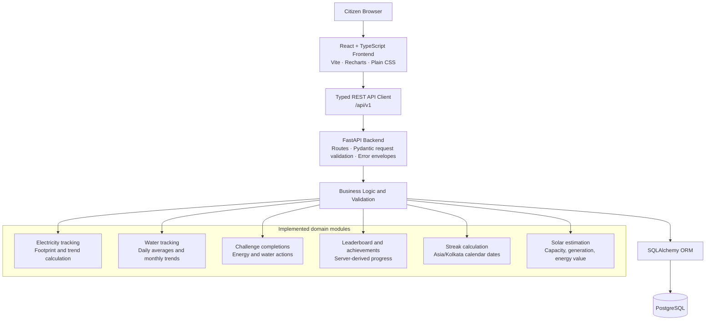
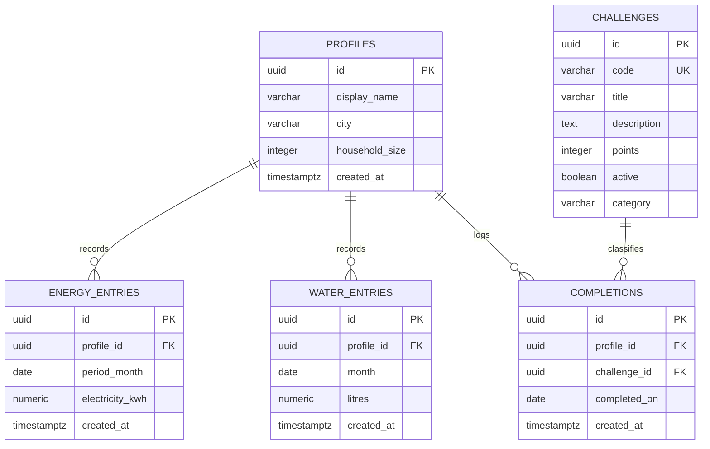

# WattWise LiFE — Implemented Architecture

This document describes the implemented HackCult 2026 submission for problem statement **HC26-GEDA01**. It supersedes the earlier GridTwin/building-anomaly planning documents.

## System architecture

## Component responsibilities

### Citizen browser

The browser holds the selected profile identifier in local storage and renders five screens: My Footprint, Water Tracker, Green Actions, Community Impact, and Solar Explorer. It does not calculate authoritative points, badges, streaks, footprint values, or solar results.

### React and TypeScript frontend

The Vite application uses typed request and response interfaces, `fetch` through a shared API client, Recharts for electricity and water history, Lucide icons, and plain CSS. It handles loading, empty, success, validation, duplicate, and network states.

### FastAPI backend

Sixteen `/api/v1` endpoints accept typed Pydantic requests and return JSON. Validation errors and domain errors use a shared envelope containing `code`, `message`, and array-shaped `details`. CORS permits the local Vite development origins.

### Business logic and validation

Deterministic services calculate:

- electricity footprint using the configured illustrative emissions factor;
- month-over-month electricity and water changes;
- daily household and optional per-person water averages;
- persisted-completion points and leaderboard order;
- five achievement progress states;
- current, longest, and recent seven-day activity streaks;
- personalized electricity nudges; and
- illustrative rooftop solar capacity, generation, and energy value.

The server returns decimal quantities as strings to preserve two- or four-decimal wire precision.

### SQLAlchemy and PostgreSQL

SQLAlchemy maps the five domain tables and manages sessions. PostgreSQL enforces foreign keys, range checks, and uniqueness. Alembic revision `0001_mission_life_mvp` creates the initial four tables and six energy challenges; additive revision `0002_phase2_water` adds household size, challenge categories, `water_entries`, and six water challenges.

## Database relationships

## Integrity rules

- `profiles.household_size` is optional and positive when present.
- Each profile has at most one electricity entry and one water entry per calendar month.
- Electricity consumption is non-negative; water consumption is positive.
- Challenge codes are unique, points are positive, and categories are `ENERGY` or `WATER`.
- A profile can complete a specific challenge at most once per calendar date.
- Deleting a profile cascades to its entries and completions; referenced challenges are restricted from deletion.
- Achievements, leaderboard rows, streaks, summaries, nudges, and estimates are derived outputs, not additional tables.

## Request and data flow

1. A screen calls the typed API client at `http://127.0.0.1:8000/api/v1`.
2. FastAPI and Pydantic validate path, query, and body values.
3. A route loads or writes domain records through a SQLAlchemy session.
4. Deterministic service functions calculate derived values where required.
5. PostgreSQL constraints reject conflicting writes as a final integrity backstop.
6. The API serializes timestamps in UTC and decimal values as strings.
7. The frontend renders persisted facts and labels estimates as illustrative.

## Deployment boundary

The implemented submission is designed for local demonstration: Vite on port `5173`, FastAPI on port `8000`, and native PostgreSQL on port `5432`. Authentication, public hosting, background workers, external utility integrations, and distributed services are outside the implemented scope.
